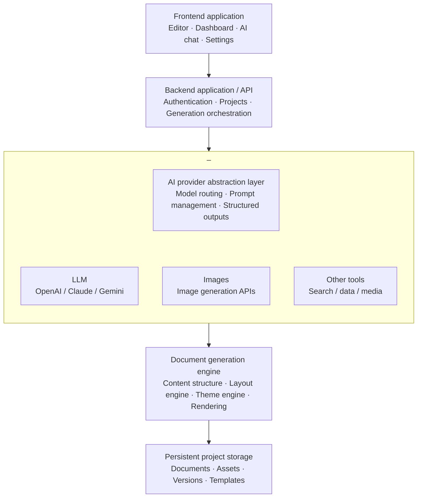

# Slider

A Slide deck creation website power by byok, github copilot or claude code. Think of gama.app. but geared towards using your already exisitng Ai infrastructures, keys,...

Build a browser-based, AI-powered visual content creation platform that enables anyone to transform an idea, prompt, document, or existing presentation into beautiful, professionally designed content.

The platform should combine the simplicity of AI generation with the flexibility of a modern visual editor. Users should be able to create presentations, documents, pitch decks, reports, social media carousels, infographics, and simple websites.

The experience should be conversational and iterative: users describe what they want, the AI creates an initial structure and design, and they can continue refining the result through natural-language instructions or direct visual editing.

The platform should take inspiration from Gamma.app's card-based editor, AI-assisted design workflow, themes, layouts, and publishing experience, while building its own architecture and visual identity.

## supported providers
Look at these folowwing  sdk 's

https://docs.github.com/en/copilot/how-tos/copilot-sdk/setup/choosing-a-setup-path
or 
https://code.claude.com/docs/en/agent-sdk/overview
or 
https://learn.chatgpt.com/docs/codex-sdk

Research the 3 sdk's also pay attention to github copilots byok (bing your own key) setups to cover other models and providers that don't have there own sdk's

### Supported AI providers
I would design the application around a provider-agnostic AI integration layer.

- OpenAI
- Anthropic (Claude)
- Google (Gemini)
- OpenRouter
- xAI
- Mistral

### Compatible custom API endpoints

Users should be able to:

- Add and manage their own API keys.
- Select their preferred AI provider.
- Choose specific models for different tasks.
- Set different models for text generation, reasoning, image generation, and editing.
- See estimated or actual API usage and costs.
- Test whether their API connection works.
- Switch providers without changing their projects.

Important engineering consideration: API keys must never be exposed in frontend code or browser storage. Use a secure backend credential vault, encrypted at rest, with server-side provider calls. Support key rotation and deletion.


## Feature
### 1. AI creation studio
- Generate from a simple text prompt.
- Paste existing text or upload files.
- Generate an outline before creating content.
- Choose content type, audience, tone, and length.
- Generate complete designs rather than just text.

### 2. Visual editor
- Card/slide-based editing.
- Drag-and-drop elements.
- Rich text editing.
- Images, icons, shapes, charts, and tables.
- Resize, reposition, duplicate, and delete elements.
- Undo/redo and autosave.
- AI editing of individual cards or entire documents.

### 3. Design system
- Theme and template library.
- Typography and color systems.
- Layout presets.
- Brand kits and custom fonts.
- Consistent styling across all cards.
- AI-generated design variations.

### 4. AI visual generation
- Generate illustrations and images.
- Create infographics.
- Generate charts from structured data.
- Find and insert relevant images.
- Replace or regenerate individual visuals.
- Support user-provided image-generation API keys.

### 5. Multiple output formats

- Presentations.
- Documents and reports.
- Pitch decks.
- Social media carousels.
- Landing pages and microsites.
- Infographics and visual reports.

### 6.Import and export

- Import PDF, PPTX, DOCX, and images.
- Export PDF and PowerPoint.
- Export individual slides as PNG.
- Share content through public or private links.
- Publish web-based presentations

### 7.Workspace management

- Projects and folders.
- Document management.
- Version history.
- Templates and reusable components.
- Sharing and collaboration.
- User permissions.

### 8. AI configuration center

- Provider connections.
- API key management.
- Model selection.
- Default model configuration.
- Per-task model routing.
- Usage and cost monitoring.

## How the BYOK architecture could work
This is probably the most important part of the project.

I would avoid building the application around one specific AI provider. Instead, create an abstraction layer that allows developers to add or replace providers without changing the presentation editor or generation logic.

A suggested architecture:



## An important architectural decision
The AI should not directly generate HTML or arbitrary frontend components for every slide.

Instead, it should generate a structured document representation, such as JSON.

For example:


```json
{
  "title": "The Future of AI",
  "theme": "modern-minimal",
  "cards": [
    {
      "type": "hero",
      "title": "The Future of AI",
      "subtitle": "A new era of productivity",
      "layout": "centered",
      "background": {
        "type": "gradient",
        "value": "dark-blue"
      }
    },
    {
      "type": "content",
      "title": "Why AI Matters",
      "layout": "two-column",
      "elements": [
        {
          "type": "text",
          "content": "AI is transforming how we work."
        },
        {
          "type": "image",
          "prompt": "Abstract AI technology illustration"
        }
      ]
    }
  ]
}
```
The frontend rendering engine interprets this structure and turns it into editable visual cards.

This separation is critical because it allows you to:

- Change AI providers without rewriting the editor.
- Regenerate one card without regenerating the entire presentation.
- Maintain consistent visual quality.
- Support multiple output formats.
- Store, version, and modify projects reliably.

## Suggested technology stack

|Component|Technology
|---|---|
|Frontend framework|Angular
|Language|TypeScript
|UI and component system|Optimus UI
|Styling|Tailwind CSS
|Component theming|Optimus UI + Tailwind CSS
|Drag and drop|Angular Material CDK
|Rich-text editor|Tiptap with Angular integration
|Backend|Node.js / NestJS|
|Database|PostgreSQL|
|ORM|Drizzle ORM|
|Authentication|Auth.js-compatible solution or custom NestJS authentication integrate with github, google, microsoft federation approach|
|File storage|S3-compatible storage|
|AI integration|Provider-agnostic AI abstraction layer|
|Background jobs|BullMQ|
|Real-time collaboration|WebSockets / Yjs
|Payments (optional)|Stripe

## Business model: no AI subscription
I would make this a core product principle, not just an optional setting.

|Feature|Business model|
|---|---|
|Access to editor|Free
|Create and manage projects|Free
|Templates and themes|Free
|AI generation|User's API key
|AI image generation|User's API key
|AI editing|User's API key
|Export PDF/PPTX|Free
|Import documents|Free
|Self-hosting|Optional
|Cloud storage|Optional paid service
|Team collaboration|Optional paid service
|Custom domains|Optional paid service


## The philosophy:

Pay for the infrastructure and product, not for bundled AI credits.

Users should not have to pay €20–€50 every month just to access an editor that calls an AI model they could access themselves.

The platform could offer:

- A completely free self-hosted version.
- A free hosted version with reasonable storage limits.
- Optional paid cloud hosting.
- Optional team and enterprise features.

This creates a different value proposition from conventional AI SaaS products.


Your ideas. Your AI. Your creativity.
An open AI-powered visual creation studio.

Create presentations, documents, websites, and visual content using the AI models you already pay for.

No bundled AI credits. No mandatory AI subscription. Just a powerful creative environment powered by your own API keys.

BYOK native
Provider agnostic
AI-powered editor
Export friendly